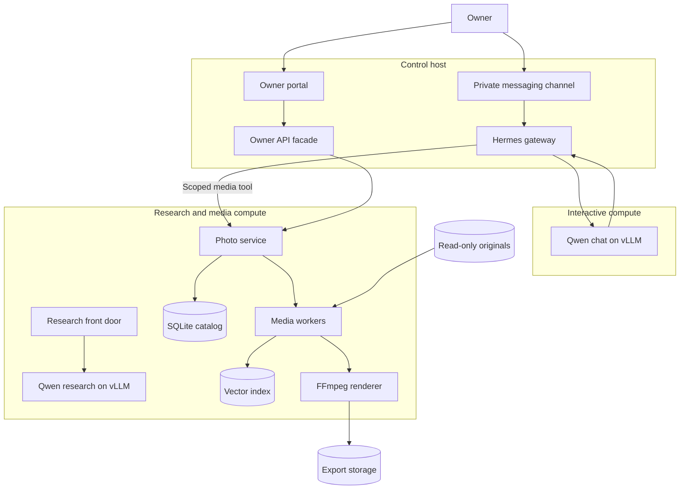
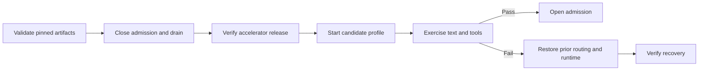
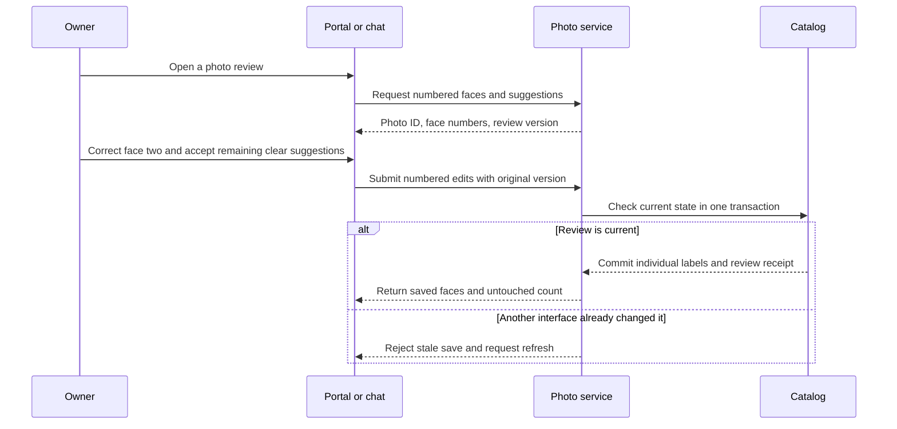

# Kendra AI Lab

A self-hosted assistant that connects private chat, a searchable media library, and a browser-based editing studio. The project grew out of a simple question: can an owner find a particular moment in years of photos and videos, correct the catalog when it gets something wrong, and turn the results into a finished video?

## System at a glance

Kendra puts three engineering problems on the same pair of GB10 compute hosts: responding to an interactive owner, running independent research requests, and indexing a growing media collection. A separate control host runs the assistant and owner interface. The durable unit of work is a catalog operation or a job. A chat session can disappear while the catalog, saved project, or completed review survives.

| Component | Responsibility | What crosses its boundary |
|---|---|---|
| Hermes gateway | Receives owner messages, maintains conversation context, and exposes scoped tools | A tool request, typed arguments, and a result |
| Owner portal | Browsing, structured search, face review, project editing, and job status | Authenticated requests to the media backend |
| Chat inference | Serves the interactive Qwen model through vLLM | Messages and tool schemas in, text or structured tool calls out |
| Research inference | Serves a separate Qwen instance behind a research front door | Research requests can use a separate serving process |
| Media API and workers | Own catalog mutations, previews, indexing, matching, and exports | Versioned records, job IDs, and bounded work batches |
| SQLite and vector storage | Keep authoritative catalog state and searchable representations | IDs link a source asset to detections, annotations, and search results |
| Model qualification harness | Exercises a candidate runtime through the same API contract an agent relies on | Synthetic requests in, structured evidence and a qualification decision out |

The two running inference containers were checked directly for this guide. Both advertise **Qwen3.8-27B**. The research and chat instances have distinct roles; the diagram does not imply that each chat request is split across two GPUs.

## Model and runtime inventory

| Model or configuration | Job in the lab | Evidence and scope |
|---|---|---|
| **Qwen3.8-27B with vLLM** | Chat reasoning, tool selection, and research inference | Served model name verified on both active compute hosts. An API alias alone does not establish weight precision, usable context, or throughput. |
| **Qwen visual annotation** | Produce a description and structured media tags | The photo annotator requests Qwen and specifies fields for activities, setting, objects, scene, details, and visible text. This identifies the client configuration, independently of the two running text endpoints. |
| **dlib face descriptors** | Compare a detected face against owner-confirmed examples | Identity matching uses embedding distance, competing identities, and correction history. The language model does not decide who a face belongs to. |
| **OpenCLIP ViT-B-32** | Put images and search text into a comparable vector space | The implemented semantic encoder selects the LAION-2B checkpoint `laion2b_s34b_b79k`. Encoder availability and index coverage are separate from the health of chat inference. |
| **DeepSeek-V4-Flash-0731** | Exercise an alternative distributed inference profile | The pinned profile specifies two-way tensor parallelism, a 131,072-token context, four sequences, and a five-token speculation setting. These are profile settings, not measured benchmark results. |
| **Earlier Qwen and SGLang profiles** | Explore long context, speculative decoding, and recovery under contention | Historical qualification and routing work. The current vLLM inventory above is the deployment snapshot. |

## Inside the model harness

A model can pass a conversational demo and still break an agent. For example, it might print convincing JSON as prose instead of returning a tool call, return two calls with arguments attached to the wrong function, or repeat a call after receiving its result. The harness tests those boundaries independently of how fluent an answer sounds.

### What a candidate must demonstrate

| Probe | What the harness observes | Failure it exposes |
|---|---|---|
| Exact text response | Expected content in the assistant message | Wrong routing, formatting drift, and repetition loops |
| Single tool call | Function name and decoded argument object | An answer that merely describes taking the action |
| Parallel tools | Calls and their arguments across one response | Dropped calls or arguments assigned to the wrong tool |
| Multi-turn tool exchange | Behavior after a tool result is fed back into the conversation | A model that can start a workflow but cannot finish it |
| Malformed arguments | Parser behavior on an invalid argument payload | Treating malformed output as executable input |
| Long-prompt retrieval | Recovery of a known synthetic value embedded in distractors | A request that fits in memory but loses the information needed to answer |
| Streaming comparison | Time to first token and completion behavior on fixed cases | A configuration that feels slower to an owner despite finishing a bulk workload quickly |

The focused smoke runner records individual requests and case results. A separate comparison runner exercises retrieval, summarization, structured output, and tool use, and refuses to overwrite an existing evidence file. These answer different release questions: does the candidate satisfy the tool contract, and what changes when the serving configuration changes? This showcase publishes the methodology without presenting historical measurements as current performance.

### How a profile switch works

The distributed-profile controller uses an exclusive lock and a durable journal. Its manifest pins the checkpoint and runtime. Before starting a candidate, it captures the prior routing state, closes admission, drains work, stops the previous model, and verifies that accelerator resources have been released. For the two-host DeepSeek profile it starts the worker before the API head. Qualification runs against the candidate before normal routing resumes. The saved state gives recovery a specific prior configuration to restore.

The test suite also covers interruption during a switch, watchdog behavior, immutable plans, release rollback, and the reboot contract. This matters on shared hardware: a watchdog that restarts yesterday’s process during a planned transition can compete with the candidate for the same memory.

## From a question to a clip

Consider a fictional query: **“Find Riley’s dance videos from last year.”** The studio turns recognizable names, media types, and dates into editable filters. A saved alias can resolve to the same person. Activity tags narrow the search, and the owner can distinguish confirmed appearances from possible matches. A missing capture date stays unknown.

Selected results become an editable project. The owner can reorder clips, adjust trims, and add titles or descriptions. The project manifest drives the render, leaving the source media available for future edits.

## How a correction becomes useful

A review shows the photograph with numbered detections and a crop for each face. The owner can correct several names together, accept the remaining clear suggestions, or leave an uncertain face alone. Confirmed examples inform subsequent face comparisons. Similarity scores are evidence for a suggestion; a reviewer makes the identity decision when the evidence is ambiguous.

A group label and a personal relationship carry different meanings. A group tag lets the owner find an event or cohort across photographs. A friendship is an explicitly recorded link between two people and can be read from either profile.

## What happens when two interfaces disagree?

A scheduled chat prompt can overlap with a portal edit. Each review is tied to a particular version of the numbered photograph. Before saving a batch, the service checks that version and applies the edits together. A stale reply cannot overwrite a newer correction. Delivery tickets also let the chat path check whether a question is still current before sending it.

## Running the workloads together

Interactive chat, bulk analysis, and rendering have different latency requirements. The lab separates media jobs from interactive requests, tracks job progress, and keeps catalog operations available independently of model interpretation. Its operational tooling includes memory and thermal checks, service health reporting, and rollback procedures for model changes.

## Follow one owner action end to end

An exact retry can return the original receipt. An ambiguous suggestion still needs an explicit choice. When a corrected name collides with a remaining suggestion, the owner resolves that face before bulk acceptance. Those rules live in the photo service, so chat and the portal agree about what was saved.

## Engineering trade-offs

- **A dedicated face matcher gives corrections a precise target.** Each owner decision attaches to a detection in a particular asset. More confirmed examples can improve reference coverage across ages and appearances without retraining model weights or promoting guesses into training labels.
- **Structured filters make search inspectable.** An owner can see and change a date range, media type, activity, or identity criterion. Catalog browsing remains useful when a model endpoint is unavailable.
- **A checkpointed job is easier to recover than a long chat turn.** A project records clip order, trims, titles, and export settings. Rendering can report its own progress, while the owner can continue searching.
- **Source access and publication have separate failure modes.** Indexing reads originals; rendering writes an output. A local export can survive a failed delivery to network storage, so a transfer retry need not repeat the render.

## About this repository

This is a public design walkthrough. Examples are illustrative. Deployment configuration, network topology, private media, identity records, chat transcripts, and operational logs belong to the private installation.
