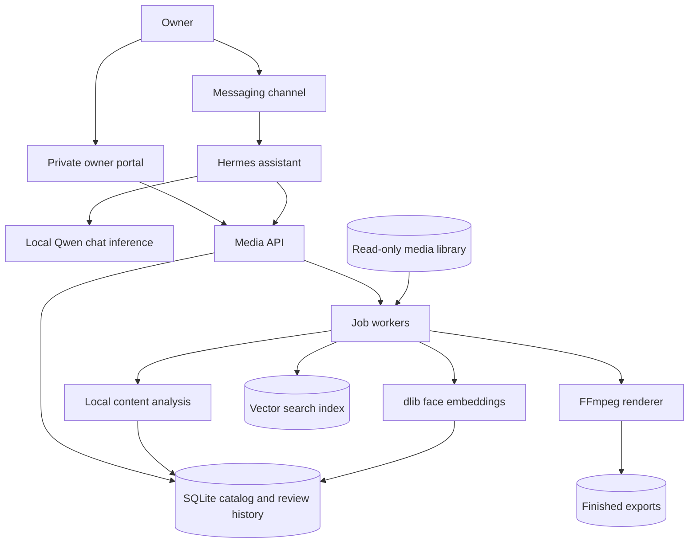

# Kendra AI Lab

A self-hosted assistant that connects private chat, a searchable media library, and a browser-based editing studio. The project grew out of a simple question: can an owner find a particular moment in years of photos and videos, correct the catalog when it gets something wrong, and turn the results into a finished video?

## Architecture

The diagram shows logical components. The owner portal and chat integration run on a control host. Two accelerated compute hosts serve local model workloads. The media service maintains its catalog separately from the original files. The messaging channel is an external delivery surface; local model inference and external message delivery have different privacy boundaries.

## From a question to a clip

Consider a fictional query: **“Find Riley’s dance videos from last year.”** The studio turns recognizable names, media types, and dates into editable filters. A saved alias can resolve to the same person. Activity tags narrow the search, and the owner can distinguish confirmed appearances from possible matches. A missing capture date stays unknown.

Selected results become an editable project. The owner can reorder clips, adjust trims, and add titles or descriptions. The project manifest drives the render, leaving the source media available for future edits.

## How a correction becomes useful

A review shows the photograph with numbered detections and a crop for each face. The owner can correct several names together, accept the remaining clear suggestions, or leave an uncertain face alone. Confirmed examples inform subsequent face comparisons. Similarity scores are evidence for a suggestion; a reviewer makes the identity decision when the evidence is ambiguous.

A group label and a personal relationship carry different meanings. A group tag lets the owner find an event or cohort across photographs. A friendship is an explicitly recorded link between two people and can be read from either profile.

## What happens when two interfaces disagree?

A scheduled chat prompt can overlap with a portal edit. Each review is tied to a particular version of the numbered photograph. Before saving a batch, the service checks that version and applies the edits together. A stale reply cannot overwrite a newer correction. Delivery tickets also let the chat path check whether a question is still current before sending it.

## Running the workloads together

Interactive chat, bulk analysis, and rendering have different latency requirements. The lab separates media jobs from interactive requests, tracks job progress, and keeps catalog operations available independently of model interpretation. Its operational tooling includes memory and thermal checks, service health reporting, and rollback procedures for model changes.

## About this repository

This is a public design walkthrough. Examples are illustrative. Deployment configuration, network topology, private media, identity records, chat transcripts, and operational logs belong to the private installation.
